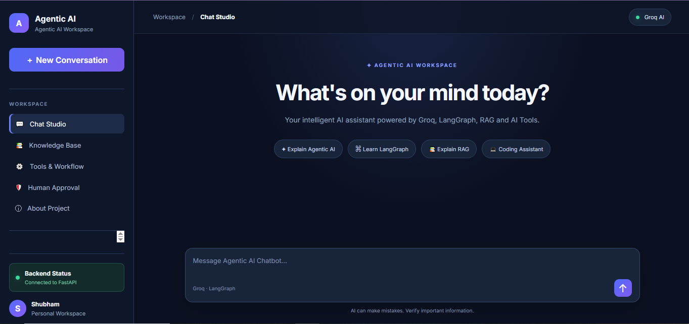

# agentic-ai-chatbot
An intelligent Agentic AI Chatbot built with LangGraph, LangChain, Groq, and FastAPI, featuring conversational memory, real-time streaming, tool integration, human-in-the-loop workflows, and document-based RAG capabilities.


# 🤖 Agentic AI Chatbot


<p align="center">
  
  
  
  
  
  
  
  
  
  
  
  
</p>

<p align="center">
  An intelligent Agentic AI Chatbot powered by LangGraph, LangChain, Groq, and FastAPI, featuring conversational memory, real-time response streaming, tool integration, Human-in-the-Loop workflows, and document-based AI capabilities.
</p>


---

## 📌 Overview

**Agentic AI Chatbot** is an AI-powered conversational application designed using modern Generative AI technologies and an agent-based architecture.

Unlike traditional chatbots, this application uses **LangGraph** to organize AI workflows and manage conversational interactions. It integrates Groq-powered LLM inference with a FastAPI backend and an interactive web-based frontend.

The application supports conversation context, chat history management, streaming responses, modular agent tools, Human-in-the-Loop workflows, and document-related RAG components.



### 🔗 Project Links

| Resource          | Link                                                                    |
| ----------------- | ----------------------------------------------------------------------- |
| GitHub Repository | [View Source Code](https://github.com/prajapatishubham336/agentic-ai-chatbot) |
| Live Demo         | Coming Soon                                                             |
| API Documentation | `http://127.0.0.1:8000/docs`                                            |
| Backend Health    | `http://127.0.0.1:8000/health`                                          |

---

## ✨ Features

- 🤖 **Agentic AI Architecture** – LangGraph-based agent workflow.
- 🧠 **Conversational Memory** – Maintains context during conversations.
- ⚡ **Real-Time Streaming** – Streams generated responses using Server-Sent Events (SSE).
- 🚀 **Groq LLM Integration** – Fast inference using Groq-powered language models.
- 🔧 **Tool Integration** – Modular tools to extend agent capabilities.
- 👤 **Human-in-the-Loop (HITL)** – Support for human intervention workflows.
- 📚 **RAG Components** – Document-based knowledge retrieval functionality.
- 💾 **SQLite Database** – Persistent conversation history.
- 🌐 **FastAPI Backend** – REST API endpoints for chatbot operations.
- 🎨 **Interactive Frontend** – Custom interface using HTML, CSS, and JavaScript.
- 🧩 **Modular Architecture** – Separate modules for agent, tools, RAG, configuration, and HITL.

---

## 🏗️ System Architecture

```text
                 ┌──────────────────────────┐
                 │      Web Frontend        │
                 │    HTML / CSS / JS       │
                 └────────────┬─────────────┘
                              │
                              ▼
                 ┌──────────────────────────┐
                 │      FastAPI Backend     │
                 │       REST API + SSE     │
                 └────────────┬─────────────┘
                              │
                              ▼
                 ┌──────────────────────────┐
                 │     LangGraph Agent      │
                 │                          │
                 │  ┌────────────────────┐  │
                 │  │ Conversational     │  │
                 │  │ Memory             │  │
                 │  └────────────────────┘  │
                 │                          │
                 │  ┌────────────────────┐  │
                 │  │ Tool Integration   │  │
                 │  └────────────────────┘  │
                 │                          │
                 │  ┌────────────────────┐  │
                 │  │ HITL Workflow      │  │
                 │  └────────────────────┘  │
                 │                          │
                 │  ┌────────────────────┐  │
                 │  │ RAG Components     │  │
                 │  └────────────────────┘  │
                 └────────────┬─────────────┘
                              │
                   ┌──────────┴──────────┐
                   ▼                     ▼
          ┌─────────────────┐   ┌─────────────────┐
          │    Groq LLM     │   │ SQLite Database │
          │  AI Inference   │   │ Chat History    │
          └─────────────────┘   └─────────────────┘
```

---

## 🛠️ Tech Stack

| Category             | Technology              |
| -------------------- | ----------------------- |
| Programming Language | Python                  |
| LLM Framework        | LangChain               |
| Agent Orchestration  | LangGraph               |
| LLM Provider         | Groq                    |
| Backend Framework    | FastAPI                 |
| ASGI Server          | Uvicorn                 |
| Database             | SQLite                  |
| Frontend             | HTML5, CSS3, JavaScript |
| Communication        | REST API, SSE           |
| AI Architecture      | Agentic AI              |
| Knowledge Retrieval  | RAG Components          |
| Human Interaction    | HITL                    |

---

## 📂 Project Structure

```text
agentic-ai-chatbot/
│
├── frontend/
│   ├── index.html
│   ├── style.css
│   └── script.js
│
├── backend/
│   ├── main.py
│   ├── requirements.txt
│   ├── .env
│   ├── .env.example
│   │
│   ├── core/
│   │   ├── __init__.py
│   │   ├── agent.py
│   │   ├── config.py
│   │   ├── hitl.py
│   │   ├── rag.py
│   │   └── tools.py
│   │
│   └── data/
│       └── uploads/
│
├── .gitignore
└── README.md
```

---

## ⚙️ Requirements

Before running the project, make sure the following tools are installed:

- Python 3.10
- Git
- Groq API Key
- VS Code or any Python IDE
- Modern web browser

### Python Dependencies

The backend uses Python libraries for API development, agent orchestration, LLM integration, and application configuration.

Main technologies include:

```text
fastapi
uvicorn
langchain
langgraph
langchain-groq
python-dotenv
```

**Install all project dependencies from the requirements file:**

```bash
pip install -r requirements.txt
```

The `requirements.txt` file contains the complete dependency list.

---

## 🚀 Installation & Setup

### Step 1: Clone the Repository

```bash
git clone https://github.com/prajapatishubham336/agentic-ai-chatbot.git
```

### Step 2: Navigate to the Project

```bash
cd agentic-ai-chatbot
```

### Step 3: Create a Virtual Environment

```bash
python -m venv venv
```

Activate the environment on Windows:

```powershell
venv\Scripts\activate
```

For Linux/macOS:

```bash
source venv/bin/activate
```

### Step 4: Navigate to Backend

```bash
cd backend
```

### Step 5: Install Dependencies

```bash
pip install -r requirements.txt
```

### Step 6: Configure Environment Variables

Create a `.env` file inside the backend directory.

Use `.env.example` as a reference.

```env
GROQ_API_KEY=your_groq_api_key_here
```

Replace the placeholder with your actual Groq API key.

**Important:** Never upload your actual `.env` file or API credentials to GitHub.

### Step 7: Run the Backend

From the backend directory:

```bash
uvicorn main:app --reload
```

Backend server:

```text
http://127.0.0.1:8000
```

FastAPI Swagger documentation:

```text
http://127.0.0.1:8000/docs
```

### Step 8: Run the Frontend

Open another terminal and navigate to the frontend directory:

```bash
cd frontend
```

Start the frontend server:

```bash
python -m http.server 5500
```

Open the application in your browser:

```text
http://127.0.0.1:5500
```

---

## 🔌 API Endpoints

The backend exposes the following API endpoints:

| Method | Endpoint                         | Description                       |
| ------ | -------------------------------- | --------------------------------- |
| GET    | `/health`                        | Check backend and database health |
| GET    | `/api/conversations`             | Retrieve conversation list        |
| GET    | `/api/conversations/{thread_id}` | Retrieve a specific conversation  |
| POST   | `/api/chat`                      | Send a chat message               |
| POST   | `/api/chat/stream`               | Receive streaming AI responses    |
| POST   | `/api/knowledge/upload`          | Upload knowledge documents        |

For request schemas, response formats, and interactive API testing, visit:

**Swagger UI:** `http://127.0.0.1:8000/docs`

---

## 🧠 Core Modules

### 1. Agent Module – `core/agent.py`

Responsible for constructing the LangGraph agent and managing the AI conversation workflow.

### 2. Configuration Module – `core/config.py`

Handles application configuration and environment-based settings.

### 3. Tools Module – `core/tools.py`

Contains modular tools that can extend the capabilities of the AI agent.

### 4. RAG Module – `core/rag.py`

Contains document-related Retrieval-Augmented Generation functionality.

### 5. HITL Module – `core/hitl.py`

Provides the structure for Human-in-the-Loop workflows and human intervention.

### 6. Main Application – `main.py`

Initializes the FastAPI application, configures API routes, and connects the backend components.

---

## 💾 Database

The application uses **SQLite** for storing conversation history.

Database functionality supports:

- Conversation persistence.
- Thread-based conversation retrieval.
- Chat history management.

The database is maintained separately from the AI agent workflow.

---

## 🔐 Environment Variables

| Variable       | Description                 |
| -------------- | --------------------------- |
| `GROQ_API_KEY` | API key for Groq LLM access |

Refer to `.env.example` for the environment configuration template.

---

## 🔒 Security & Best Practices

- Store API credentials in environment variables.
- Never commit `.env` files to version control.
- Keep `.env.example` free of real API keys.
- Validate uploaded files before processing.
- Avoid logging sensitive user information.
- Exclude local databases and private uploads from public repositories.

---

## 🛣️ Future Enhancements

- [ ] Advanced multi-agent orchestration.
- [ ] Reliable real-time web search with source citations.
- [ ] Complete document ingestion and vector database integration.
- [ ] Advanced RAG retrieval and evaluation.
- [ ] LLM evaluation and observability.
- [ ] Docker containerization.
- [ ] Cloud deployment.
- [ ] Authentication and user management.
- [ ] Automated testing and CI/CD pipeline.

---

## 🎯 Learning Outcomes

This project demonstrates practical experience with:

- Agentic AI application development.
- LangGraph workflow orchestration.
- LLM integration using Groq.
- LangChain application development.
- FastAPI backend development.
- Conversational memory management.
- Real-time response streaming.
- Tool integration and agent workflows.
- Retrieval-Augmented Generation concepts.
- Human-in-the-Loop workflows.
- SQLite database integration.

---

## 🤝 Contributing

Contributions, suggestions, and improvements are welcome!

1. Fork this repository.
2. Create a feature branch.
3. Make your changes.
4. Commit your changes.
5. Push the branch.
6. Create a Pull Request.

---

## 📄 License

A license has not yet been specified. Add a `LICENSE` file if you intend to distribute this project under a particular open-source license.

---

## 👨‍💻 Author

**Shubham Prajapati**

AI / ML Engineer | Generative AI | Machine Learning


\<p align="center">
&#x20; ⭐ If you find this project useful, consider giving it a star!
\</p>
